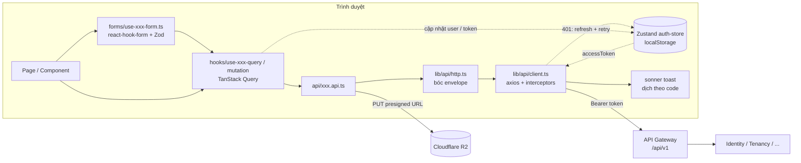

<div align="center">

<h1>Rentify · Landlord Web</h1>

<p>Ứng dụng web quản lý nhà trọ cho chủ trọ (và quản trị viên) của hệ thống Rentify.</p>

<p>
  <a href="https://github.com/pbl6-home-renter/fe/actions/workflows/deploy.yml"></a>
  
  
  
  
  
  
  
  
  
  
</p>

<p>
  <a href="#giới-thiệu">Giới thiệu</a> •
  <a href="#tính-năng-nổi-bật">Tính năng</a> •
  <a href="#bắt-đầu-nhanh">Bắt đầu nhanh</a> •
  <a href="#scripts">Scripts</a> •
  <a href="#kiến-trúc">Kiến trúc</a> •
  <a href="#đa-ngôn-ngữ-i18n">i18n</a> •
  <a href="#triển-khai">Triển khai</a> •
  <a href="#đóng-góp">Đóng góp</a>
</p>

</div>

---

## Giới thiệu

`fe` là giao diện web của **Rentify** — hệ thống quản lý cho thuê phòng trọ gồm web cho chủ trọ, ứng dụng Android cho người thuê/chủ trọ và một tầng AI nhẹ. Web là một SPA viết bằng React + Vite + TypeScript, gọi toàn bộ backend qua [`api-gateway`](https://github.com/pbl6-home-renter/api-gateway) (`/api/v1/...`) và xây dựng theo hợp đồng OpenAPI trong [`be`](https://github.com/pbl6-home-renter/be) (thư mục `api-docs/` trong workspace).

Ứng dụng hỗ trợ ba vai trò `landlord`, `tenant`, `admin`; mỗi vai trò có menu và trang chủ riêng.

> [!NOTE]
> Dự án đang ở giai đoạn dựng nền: khung ứng dụng, xác thực, upload media và design system đã hoạt động; phần lớn trang nghiệp vụ (phòng, hợp đồng, hóa đơn, sự cố, chat…) hiện mới là trang giữ chỗ (`DashboardOverview`) để hoàn thiện ở các task sau.

## Tính năng nổi bật

- **Xác thực đầy đủ** — đăng nhập, đăng ký, quên mật khẩu, đặt lại mật khẩu (`/login`, `/register`, `/forgot-password`, `/reset-password`); access token tự gắn `Authorization: Bearer`, 401 được **refresh token một lần** rồi gọi lại request.
- **Định tuyến theo vai trò** — `ProtectedRoute` kiểm tra đăng nhập, trạng thái khóa (`LOCKED` → `/403`) và role; `/` tự chuyển về trang chủ của role (`/dashboard` cho landlord/tenant, `/admin` cho admin); trang `403` và `404`.
- **Khung ứng dụng (app shell)** — sidebar + header + menu người dùng; menu điều hướng khai báo theo role trong `src/config/navigation.config.ts`, route theo role trong `src/app/routes/roles/`:
  - *Landlord:* tổng quan, phòng, người thuê, hợp đồng, hóa đơn, sự cố, chat, cài đặt; thêm các route `/buildings`, `/contracts/new`, `/contracts/templates`, `/meter-readings`.
  - *Tenant:* tổng quan, phòng của tôi, hợp đồng, hóa đơn, sự cố, tìm bạn ở ghép (`/roommates`), chat, cài đặt.
  - *Admin:* thống kê hệ thống, duyệt, người dùng, nhật ký kiểm toán, cài đặt.
- **Upload media qua presigned URL** — module `src/features/media` lo trọn luồng presign → `PUT` thẳng lên Cloudflare R2 → complete, có progress, hủy upload, validate MIME/kích thước (tối đa 10 MB) và hiển thị file private.
- **Toast tập trung** — thông báo thành công/lỗi API được dịch từ `code` của backend ngay trong interceptor axios, không rải rác trong component.
- **Đa ngôn ngữ** — tiếng Việt (mặc định) và tiếng Anh, chuyển ngôn ngữ ngay trên header; có công cụ kiểm tra key thiếu và đồng bộ locale.
- **Design system** — bộ component `ui/` (Button, Input, Dialog, Select, ProgressMeter…) và `feedback/` (Skeleton, EmptyState, ErrorState…), xem trực tiếp tại route `/design-system`.

## Tech stack

| Hạng mục | Công nghệ |
|---|---|
| Framework | React 19.2, React Router 7.18 (`createBrowserRouter`) |
| Build tool | Vite 8.3 (`@vitejs/plugin-react`), alias `@/` → `src/` |
| Ngôn ngữ | TypeScript ~6.0 |
| Server state | TanStack Query 5 |
| Client state | Zustand 5 (`persist` → `localStorage`, key `rentify_auth_storage`) |
| Form & validate | react-hook-form 7 + Zod 4 (`@hookform/resolvers`) |
| HTTP | axios 1.20 |
| Styling | Tailwind CSS 4.3 (`@tailwindcss/vite`), `clsx` + `tailwind-merge`, `lucide-react` |
| Thông báo | sonner |
| i18n | i18next 26 + react-i18next 17, `i18n-unused` |
| Chất lượng code | ESLint 10 + typescript-eslint, Husky + lint-staged |
| Đóng gói | Docker multi-stage (Node 24 Alpine → nginx Alpine) |

## Bắt đầu nhanh

### Yêu cầu

- **Node.js 24** (phiên bản dùng trong `Dockerfile` và CI) và npm.
- Một API Gateway đang chạy (mặc định `http://localhost:3000`) cùng các service phía sau — xem [`api-gateway`](https://github.com/pbl6-home-renter/api-gateway).

### Cài đặt

```bash
git clone https://github.com/pbl6-home-renter/fe.git
cd fe
npm install          # chạy luôn script "prepare" để cài Husky hook
```

### Cấu hình

```bash
cp .env.example .env.local
```

> [!IMPORTANT]
> `vite.config.ts` **không** cấu hình proxy. Với giá trị mặc định `VITE_API_BASE_URL=/api/v1`, khi chạy `npm run dev` request sẽ đi vào chính Vite dev server. Khi phát triển local, hãy trỏ thẳng tới gateway, ví dụ `VITE_API_BASE_URL=http://localhost:3000/api/v1`. Gateway mặc định cho phép CORS từ `http://localhost:5173`.

### Chạy

```bash
npm run dev          # http://localhost:5173
```

Ở chế độ dev, `window.authStore` và `window.apiClient` được gắn ra global để tiện debug trong DevTools.

## Biến môi trường

Biến `VITE_*` được Vite nhúng vào bundle **lúc build**, không đọc lúc chạy.

| Tên | Bắt buộc | Mặc định | Mô tả |
|---|---|---|---|
| `VITE_API_BASE_URL` | Không | `/api/v1` | Base URL của API Gateway mà axios gọi tới (cả `/auth/refresh`). Trong Docker image được truyền qua build arg cùng tên. |

## Scripts

| Lệnh | Mô tả |
|---|---|
| `npm run dev` | Chạy Vite dev server có HMR. |
| `npm run build` | Type-check (`tsc -b`) rồi build production vào `dist/`. |
| `npm run preview` | Phục vụ thử bản build trong `dist/`. |
| `npm run lint` | Chạy ESLint toàn repo. |
| `npm run i18n:check` | Liệt kê translation key được dùng trong code nhưng thiếu trong locale. |
| `npm run i18n:unused` | Liệt kê key có trong locale nhưng không còn được dùng. |
| `npm run i18n:clean` | Xóa các key không dùng khỏi file locale. |
| `npm run i18n:sync` | Đồng bộ cấu trúc key từ `vi/` sang `en/` (chỉ thêm key còn thiếu, không ghi đè bản dịch có sẵn). |

> [!NOTE]
> Repo không có test script — theo quyết định của nhóm, frontend được kiểm tra bằng `build` và `lint`. Husky `pre-commit` chạy `lint-staged` (`eslint --fix` cho `src/**/*.{ts,tsx}`) rồi `npm run build`.

## Cấu trúc thư mục

```text
fe/
├── .github/workflows/deploy.yml   # CI: lint + build + push image + deploy EC2
├── docs/                          # Tài liệu kiến trúc, i18n, upload media
├── scripts/sync-i18n.cjs          # Script cho npm run i18n:sync
├── src/
│   ├── app/                       # Provider, routes (theo role), layouts, trang hệ thống
│   │   ├── layouts/               #   auth-layout, dashboard-layout (sidebar, header, user menu)
│   │   ├── pages/                 #   dashboard-overview, design-system-showcase, 403, 404
│   │   └── routes/                #   protected/public route, roles/*.routes.tsx
│   ├── components/
│   │   ├── ui/                    # Primitive của design system
│   │   ├── feedback/              # Loading, Skeleton, EmptyState, ErrorState, AlertBanner
│   │   └── guards/                # <Can> ẩn/hiện theo role
│   ├── config/                    # Menu điều hướng & metadata cổng theo role
│   ├── features/
│   │   ├── auth/                  # api/ constants/ forms/ hooks/ pages/ types/
│   │   └── media/                 # Upload presigned, xem file private, xóa media
│   ├── hooks/                     # Hook generic (useDebounce, useDisclosure)
│   ├── i18n/                      # i18next + locales/{vi,en}/{common,auth,media}.json
│   ├── lib/
│   │   ├── api/                   # axios client, refresh token, http helpers, errors, api-messages
│   │   ├── query/                 # QueryClient, kiểu MutationHookOptions
│   │   ├── utils/                 # cn, format (formatVnd, formatDate…)
│   │   └── form.ts                # getFieldError, setFormApiErrors
│   ├── stores/                    # Zustand (auth-store)
│   └── types/                     # Envelope API, phân trang, User, Role
├── Dockerfile                     # Build static → nginx, cổng 5173
├── nginx.conf                     # SPA fallback, gzip, cache /assets/
└── i18n-unused.config.cjs         # Cấu hình i18n:check / unused / clean
```

## Kiến trúc

Mỗi feature trong `src/features/<tên>/` chia ba tầng, tầng trên chỉ gọi tầng ngay dưới: **page → form hook → query/mutation hook → `*.api.ts`**. Feature không gọi axios trực tiếp mà luôn qua `http` (helper đã bóc envelope `{ statusCode, code, data }`). Không dùng barrel `index.ts`; `lib/`, `types/`, `components/`, `hooks/` không import từ `features/` hay `app/`.



- **Server state** (dữ liệu từ API) nằm trong cache TanStack Query; query key khai báo ở `features/<tên>/constants/` dạng `<TÊN>_QUERY_KEYS`. Mặc định `staleTime` 5 phút, không retry lỗi 4xx, tắt refetch khi focus.
- **Client state** (phiên đăng nhập, token, user) nằm trong Zustand `auth-store`, persist vào `localStorage`.
- **Toast** thành công/lỗi chỉ phát ra từ interceptor trong `lib/api/client.ts`; có thể tắt bằng `skipSuccessToast` / `skipErrorToast`.
- **Upload file** là ngoại lệ duy nhất không đi qua `http`: trình duyệt `PUT` thẳng lên R2 theo presigned URL do Identity-Service cấp.

Chi tiết và checklist thêm feature mới: [`docs/architecture.md`](docs/architecture.md).

## Đa ngôn ngữ (i18n)

- Ngôn ngữ: **`vi`** (mặc định, nguồn chuẩn — fallback cũng là `vi`) và **`en`**.
- Namespace: `common` (mặc định), `auth`, `media` — file tại `src/i18n/locales/{vi,en}/<namespace>.json`.
- Key đặt theo `camelCase`, phân cấp theo ngữ cảnh; không hardcode chuỗi hiển thị trong JSX/TSX; trong config/constants chỉ lưu key (ví dụ `titleKey`), không gọi `i18n.t(...)`.
- Thông báo API: thêm bản dịch `<ns>:apiSuccess.<CODE>` / `<ns>:apiErrors.<CODE>` là toast tự hiện.

Quy trình khi thêm/sửa text:

```bash
# 1. Thêm key vào src/i18n/locales/vi/<namespace>.json
npm run i18n:sync     # 2. Tạo key còn thiếu ở en/ (giá trị tạm lấy từ vi/) rồi dịch lại
npm run i18n:check    # 3. Đảm bảo không còn key bị thiếu
npm run build         # 4. Type-check key (typed i18next)
```

Xem đầy đủ quy chuẩn tại [`docs/i18n-guidelines.md`](docs/i18n-guidelines.md).

## API / Tài liệu

| Tài liệu | Nội dung |
|---|---|
| [`docs/architecture.md`](docs/architecture.md) | Tổ chức `src/`, envelope & phân trang, toast, query key, form, component, checklist feature mới |
| [`docs/i18n-guidelines.md`](docs/i18n-guidelines.md) | Namespace, quy tắc đặt key, interpolation, pluralization |
| [`docs/media-upload-guide.md`](docs/media-upload-guide.md) | Luồng upload 3 bước, bảng `purpose`/`ownerType`, hook `useMediaUpload`, `useMediaObjectUrl` |
| [`be`](https://github.com/pbl6-home-renter/be) (`api-docs/`) | Hợp đồng OpenAPI 3.0 chuẩn — DTO trong `features/*/types/*.dto.ts` được chép từ đây |

## Triển khai

Workflow [`.github/workflows/deploy.yml`](.github/workflows/deploy.yml) chạy khi push lên `main` (hoặc chạy tay qua `workflow_dispatch`):

1. `npm ci --ignore-scripts` → `npm run lint` → `npm run build`.
2. Build Docker image `linux/amd64` và push lên Docker Hub với tag `<DOCKERHUB_USERNAME>/pbl6-web:latest`; build arg `VITE_API_BASE_URL=http://<EC2_HOST>/api/v1`.
3. SSH vào host EC2 **edge**, `git pull` repo [`infra`](https://github.com/pbl6-home-renter/infra) rồi chạy `DEPLOY_STACK=edge bash ./scripts/deploy.sh web caddy`. Bước này tự bỏ qua nếu chưa cấu hình secret `EC2_HOST` / `EC2_SSH_KEY`.

Secrets cần có trên GitHub: `DOCKERHUB_USERNAME`, `DOCKERHUB_TOKEN`, `EC2_HOST`, `EC2_USER` (mặc định `ubuntu`), `EC2_SSH_KEY`.

Image chạy nginx lắng nghe cổng **5173** (có `HEALTHCHECK`), phục vụ SPA với fallback về `index.html`, gzip, cache `immutable` một năm cho `/assets/` và `no-cache` cho `index.html`. Caddy trên host edge đứng phía trước.

<details>
<summary>Build và chạy image thủ công</summary>

```bash
docker build -t rentify-web --build-arg VITE_API_BASE_URL=http://localhost:3000/api/v1 .
docker run --rm -p 5173:5173 rentify-web
```

</details>

## Đóng góp

- **Nhánh:** `main` ← `develop` ← `feature/<id>-<slug>` (ngoài ra `fix/`, `hotfix/`, `docs/`, `ci/`). Mã task theo `pm/phase-N/issues/`, ví dụ `feature/p6-08-room-list`.
- **Không push trực tiếp** lên `main` hoặc `develop`; mọi thay đổi qua Pull Request, **squash merge**, cần **≥ 1 reviewer**.
- **Commit message** bằng tiếng Anh theo [Conventional Commits](https://www.conventionalcommits.org/), ví dụ `feat(media): add presigned upload pattern`, `refactor(fe): ...`, `ci(deploy): ...`.
- Trước khi mở PR, chạy:

  ```bash
  npm run lint
  npm run build
  npm run i18n:check
  ```

- Theo quy ước trong [`docs/architecture.md`](docs/architecture.md): không tạo file barrel `index.ts`, không viết file test `*.test.ts`, mọi thay đổi API phải được cập nhật trong [`be`](https://github.com/pbl6-home-renter/be) trước.

## Hệ sinh thái Rentify

| Repo | Vai trò |
|---|---|
| [`api-gateway`](https://github.com/pbl6-home-renter/api-gateway) | Reverse proxy: định tuyến theo prefix, xác thực JWT/JWKS, rate limit |
| [`Identity-Service`](https://github.com/pbl6-home-renter/Identity-Service) | Xác thực, người dùng, hồ sơ chủ trọ; phát hành JWT RS256 |
| [`Tenancy-Service`](https://github.com/pbl6-home-renter/Tenancy-Service) | Tòa nhà, phòng, đơn vị hành chính |
| [`boilerplate`](https://github.com/pbl6-home-renter/boilerplate) | Template NestJS mà mọi backend service được fork từ |
| [`be`](https://github.com/pbl6-home-renter/be) | Hợp đồng OpenAPI 3.0 chuẩn (canonical) |
| **[`fe`](https://github.com/pbl6-home-renter/fe)** | Web cho chủ trọ (React + Vite) |
| [`mobile`](https://github.com/pbl6-home-renter/mobile) | Ứng dụng Android cho người thuê & chủ trọ |
| [`infra`](https://github.com/pbl6-home-renter/infra) | Docker Compose + Caddy cho hai host EC2 |

## Giấy phép

Dự án học thuật thuộc học phần PBL6 — Trường Đại học Bách khoa, Đại học Đà Nẵng. Chưa phát hành theo giấy phép mã nguồn mở.
