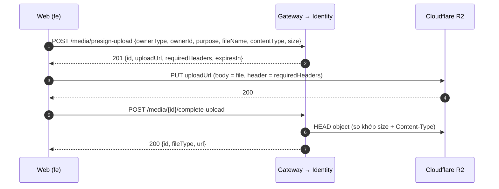

# Hướng Dẫn Upload File (Media) — Rentify Frontend

Tài liệu này hướng dẫn cách upload ảnh/PDF lên storage và hiển thị lại file trong `fe/`. Mọi upload (avatar, ảnh phòng, giấy tờ, hợp đồng ký, ảnh công tơ…) đều đi qua module `src/features/media/`. **Không** tự viết lại luồng presign/PUT/complete trong từng màn hình.

Contract gốc: `api-docs/src/paths/media/*` (Apidog folder **Media**). Backend: Identity-Service `src/modules/media`.

---

## 1. Luồng Upload 3 Bước

File **không** đi qua API Gateway/Identity. Server chỉ cấp "vé" (presigned URL), trình duyệt tự `PUT` file thẳng lên Cloudflare R2, rồi báo server kiểm tra.



Tại sao như vậy: file không làm nghẽn gateway/service, không tốn băng thông EC2, và hỗ trợ progress bar thật.

Kết quả cuối cùng (`MediaCompleteUploadResponseDto`) có 2 thứ cần dùng:

| Field | Dùng để |
|---|---|
| `id` | Gửi vào API nghiệp vụ, ví dụ `photoMediaIds` khi tạo phòng, `signedContractMediaId` khi kích hoạt HĐ, `evidenceMediaId` khi ghi chỉ số. |
| `url` | Hiển thị file. Purpose **public** → URL R2 tuyệt đối, dùng thẳng trong ``. Purpose **private** → `/api/v1/media/{id}`, phải dùng `useMediaObjectUrl` (mục 4.C). |

File được gắn với thực thể cha ngay lúc presign qua `ownerType` + `ownerId` + `purpose`. Không có bước "attach" riêng, nên **thực thể cha phải tồn tại trước** (có `ownerId`).

---

## 2. Cấu Trúc Module

```
fe/src/features/media/
├── api/media.api.ts                 # mediaApi: presignUpload, putToStorage, completeUpload, getBlob, delete
├── constants/media.constants.ts     # MEDIA_PURPOSE_RULES, MEDIA_MAX_SIZE_BYTES, getMediaAccept, mã lỗi/thành công
├── types/media.dto.ts               # MediaOwnerType, MediaPurpose, MediaContentType, MediaCaptureSource + DTO
├── utils/upload-media.ts            # uploadMedia() (cả luồng), validateMediaFile(), MediaUploadError
├── validations/media.validation.ts  # createMediaFileSchema(), createMediaFilesSchema() cho react-hook-form
└── hooks/media/
    ├── use-media-upload.ts              # useMediaUpload(): mutation + progress + cancel
    ├── use-media-object-url-query.ts    # useMediaObjectUrl(): hiển thị file private
    └── use-delete-media-mutation.ts     # useDeleteMediaMutation()
```

Trong component chỉ cần dùng **hooks** (`useMediaUpload`, `useMediaObjectUrl`, `useDeleteMediaMutation`). Có thể gọi trực tiếp `uploadMedia()` ngoài React (ví dụ upload nhiều file song song).

---

## 3. Bảng `purpose`

Chọn `purpose` theo nghiệp vụ; `ownerType` phải nằm trong cột tương ứng, nếu không backend trả `422 INVALID_PURPOSE` (FE chặn trước bằng `MEDIA_PURPOSE_RULES`).

| `purpose` | `ownerType` | MIME | Hiển thị | Ai được upload | Ghi chú |
|---|---|---|---|---|---|
| `avatar` | `user` | jpeg, png, webp | public | chính user đó | 1 file/owner, upload mới tự thay file cũ |
| `cover_photo` | `building`, `room` | jpeg, png, webp | public | landlord sở hữu | 1 file/owner, upload mới tự thay file cũ |
| `gallery_photo` | `building`, `room` | jpeg, png, webp | public | landlord sở hữu | |
| `ownership_proof` | `building` | jpeg, png, webp, pdf | private | landlord sở hữu | không xóa được khi building đã `approved` |
| `cccd_front`, `cccd_back` | `user`, `contract_member` | jpeg, png, webp | private | chính user, thành viên HĐ, landlord | |
| `contract_template` | `contract` | pdf | private | landlord sở hữu | |
| `contract_signed` | `contract` | jpeg, png, webp, pdf | private | landlord sở hữu | không xóa được khi HĐ đã có hiệu lực |
| `meter_reading_evidence` | `meter_reading` | jpeg, png, webp | private | landlord; tenant chỉ khi `captureSource: 'camera_direct'` | |
| `issue_photo` | `issue_report` | jpeg, png, webp | private | — | **chưa hỗ trợ** (503) |
| `chat_attachment` | `message` | jpeg, png, webp, pdf | private | — | **chưa hỗ trợ** (503) |

Giới hạn chung: tối đa **10 MB**/file, không nhận SVG/HTML/video. Admin luôn được upload.

---

## 4. Cách Sử Dụng

### A. Upload một file (ví dụ: avatar)

```tsx
import { useTranslation } from 'react-i18next';
import { useMediaUpload } from '@/features/media/hooks/media/use-media-upload';
import { getMediaAccept } from '@/features/media/constants/media.constants';
import { MediaOwnerType, MediaPurpose } from '@/features/media/types/media.dto';
import { ProgressMeterTrack } from '@/components/ui/progress-meter';
import { useAuthStore } from '@/stores/auth-store';

export const AvatarUploader = () => {
  const { t } = useTranslation();
  const userId = useAuthStore((state) => state.user?.id);
  const { upload, isUploading, progress, cancel, data } = useMediaUpload();

  const onFileChange = (event: React.ChangeEvent<HTMLInputElement>) => {
    const file = event.target.files?.[0];
    event.target.value = ''; // cho phép chọn lại cùng file
    if (!file || !userId) return;

    upload({
      file,
      ownerType: MediaOwnerType.USER,
      ownerId: userId,
      purpose: MediaPurpose.AVATAR,
    });
  };

  return (
    <div>
      <input
        type="file"
        accept={getMediaAccept(MediaPurpose.AVATAR)}
        onChange={onFileChange}
        disabled={isUploading}
      />
      {isUploading && (
        <>
          <ProgressMeterTrack value={progress} showValue />
          <button type="button" onClick={cancel}>{t('cancel')}</button>
        </>
      )}
      {data && }
    </div>
  );
};
```

`useMediaUpload(options?)` nhận cùng options như `useAppMutation` và trả về:

| Giá trị | Ý nghĩa |
|---|---|
| `upload(vars)` / `uploadAsync(vars)` | Chạy cả luồng presign → PUT → complete. `uploadAsync` trả `Promise<MediaCompleteUploadResponseDto>`. |
| `progress` | % đã PUT lên R2 (0–100) của lần upload gần nhất. |
| `isUploading` | Đang chạy (bằng `isPending`). |
| `cancel()` | Hủy mọi upload đang chạy của hook (kể cả khi đang PUT). Hook cũng tự hủy khi component unmount. |
| `reset()` | Hủy + xóa `data`/`error`/`progress`. |
| `data`, `error`, … | Như `useMutation`. |

Mặc định: thành công → toast `MEDIA_UPLOAD_COMPLETED`; lỗi → toast theo mã lỗi (mục 5). Tắt bằng `useMediaUpload({ suppressErrorToast: true, successCode: undefined })`.

### B. Upload nhiều file rồi gửi `mediaId` vào API nghiệp vụ (ví dụ: ảnh phòng)

`ownerId` phải là id của phòng **đã tồn tại**. Upload tuần tự bằng `uploadAsync` để progress dễ hiểu và tránh toast lặp:

```tsx
const { uploadAsync, progress, isUploading } = useMediaUpload({ successCode: undefined });

const uploadGallery = async (roomId: string, files: File[]): Promise<string[]> => {
  const mediaIds: string[] = [];
  for (const file of files) {
    const media = await uploadAsync({
      file,
      ownerType: MediaOwnerType.ROOM,
      ownerId: roomId,
      purpose: MediaPurpose.GALLERY_PHOTO,
    });
    mediaIds.push(media.id);
  }
  return mediaIds; // gửi vào API nghiệp vụ, ví dụ photoMediaIds
};
```

Muốn upload song song: gọi trực tiếp `uploadMedia()` từ `utils/upload-media.ts` với `Promise.all`, tự quản lý progress từng file qua `onProgress`.

### C. Hiển thị file private

`url` của file private (`/api/v1/media/{id}`) cần Bearer token nên **không** dùng thẳng được trong `` / `<a href>`. Dùng `useMediaObjectUrl`: hook tự tải blob qua `apiClient` và trả object URL (tự revoke khi unmount). Với URL public, hook trả nguyên URL, nên có thể dùng cho mọi loại `url`.

```tsx
import { useMediaObjectUrl } from '@/features/media/hooks/media/use-media-object-url-query';

const SignedContractPreview = ({ url }: { url: string }) => {
  const { src, isLoading } = useMediaObjectUrl(url);
  if (isLoading || !src) return <span>…</span>;
  return <iframe src={src} title="contract" className="h-150 w-full" />;
};
```

### D. Xóa file

```tsx
const deleteMedia = useDeleteMediaMutation({ successMessage: t('success') });
deleteMedia.mutate(mediaId);
```

- Chỉ người upload hoặc admin được xóa.
- Không cần xóa avatar/cover cũ trước khi upload file mới: complete file mới tự thay file cũ.
- File đang làm bằng chứng (giấy tờ building đã duyệt, HĐ đã có hiệu lực) trả `409 CANNOT_DELETE`.

### E. Validate trong form (react-hook-form + zod)

```ts
import { z } from 'zod';
import { createMediaFileSchema, createMediaFilesSchema } from '@/features/media/validations/media.validation';
import { MediaPurpose } from '@/features/media/types/media.dto';

export const roomPhotosSchema = z.object({
  cover: createMediaFileSchema(MediaPurpose.COVER_PHOTO),
  gallery: createMediaFilesSchema(MediaPurpose.GALLERY_PHOTO, 1), // tối thiểu 1 ảnh
});
```

`message` của lỗi là **mã lỗi** (ví dụ `MEDIA_FILE_TOO_LARGE`), hiển thị bằng `getApiErrorMessage(errors.cover?.message ?? '')` từ `@/lib/api-code-i18n`. Ngoài form có thể gọi `validateMediaFile(file, purpose)` (trả mã lỗi hoặc `null`).

---

## 5. Mã Lỗi & Cách Xử Lý

Bản dịch mã lỗi/thành công riêng của media nằm ở namespace `media` (`src/i18n/locales/{vi,en}/media.json`, mục `apiErrors` / `apiSuccess`); mã dùng chung (`FORBIDDEN`, `SERVICE_UNAVAILABLE`…) vẫn ở `common`. `getApiErrorMessage` tra lần lượt `auth` → `media` → `common`, nên toast/`getErrorMessage(error)` tự hiển thị đúng câu. Lỗi phía client là `MediaUploadError` (có `error.code`); lỗi từ API là `AxiosError` (dùng `getApiErrorCode(error)`).

| Mã | Nguồn | Nguyên nhân | FE nên làm |
|---|---|---|---|
| `MEDIA_FILE_REQUIRED` / `MEDIA_FILE_EMPTY` | client | Chưa chọn file / file 0 byte | Yêu cầu chọn lại. |
| `MEDIA_FILE_TOO_LARGE` | client | > 10 MB | Báo lỗi; có thể nén ảnh trước khi upload. |
| `MEDIA_TYPE_NOT_ALLOWED` | client / presign 422 / complete 422 | MIME không hợp lệ với purpose, hoặc file trên R2 khác lúc presign | Báo lỗi, chọn file khác. |
| `INVALID_PURPOSE` | client / presign 422 | Sai cặp `ownerType` – `purpose` | Lỗi lập trình, sửa code gọi. |
| `FORBIDDEN` | presign / complete / get / delete 403 | Không có quyền với thực thể cha, hoặc thực thể cha không tồn tại; tenant upload ảnh công tơ không phải `camera_direct` | Báo không có quyền. |
| `MEDIA_STORAGE_UPLOAD_FAILED` | client (PUT R2) | Mạng lỗi, URL hết hạn, CORS bucket, sai header | Cho phép thử lại (gọi lại `upload`, sẽ presign mới). |
| `UPLOAD_NOT_COMPLETED` | complete 409 | Server chưa thấy file trên R2 | Thử lại cả luồng. |
| `TICKET_EXPIRED` | complete 410 | Quá `expiresIn` (15 phút) | Thử lại cả luồng. |
| `MEDIA_DELETED` | complete / get / delete 410 | File đã bị xóa | Ẩn file khỏi UI. |
| `CANNOT_DELETE` | delete 409 | File đang là bằng chứng | Ẩn nút xóa trong các trạng thái này. |
| `SERVICE_UNAVAILABLE` | 503 | R2 chưa cấu hình, hoặc `issue_report`/`message` chưa hỗ trợ | Báo thử lại sau. |
| `MEDIA_UPLOAD_CANCELED` | client | Gọi `cancel()` hoặc unmount | Thường bỏ qua. |

---

## 6. Lưu Ý Quan Trọng

1. **Không dùng `apiClient` để PUT lên `uploadUrl`.** `apiClient` gắn `Authorization` + `Content-Type: application/json` và chạy luồng refresh token khi gặp 401/403. `mediaApi.putToStorage` đã dùng `axios` thuần.
2. **Chỉ gửi đúng `requiredHeaders`.** `Content-Type` được ký vào URL; sai/thiếu → R2 trả 403. Không thêm header tùy ý.
3. **`size` và `contentType` phải khớp file thật.** `uploadMedia` lấy từ `file.size`, `file.type`. Đừng sửa `File` sau khi presign (ví dụ nén ảnh): hãy nén **trước** rồi mới gọi `upload`.
4. **Đuôi `fileName` phải khớp MIME.** `uploadMedia` tự thêm đuôi chuẩn (`.jpg`, `.png`, `.webp`, `.pdf`) nếu tên file thiếu/sai đuôi (ảnh chụp từ camera, paste clipboard…).
5. **CORS của bucket R2** phải cho phép `PUT` với header `Content-Type` từ origin web (localhost dev + domain staging). Nếu PUT lỗi CORS trên console → báo BE/infra cấu hình bucket, không sửa ở FE.
6. **Gateway không mở public `GET /media/*`**, nên kể cả khách chưa đăng nhập cũng không xem được file private; file public luôn dùng URL R2.
7. Không có resize/thumbnail phía server. Ảnh lớn nên nén phía client trước khi upload.
8. Kiểu dữ liệu trong `types/media.dto.ts` và `MEDIA_PURPOSE_RULES` được viết tay theo contract. Khi `api-docs` hoặc policy backend đổi, cập nhật 2 file này.

---

## 7. Chưa Hỗ Trợ (Theo Dõi Ở Backend)

| Hạng mục | Hiện trạng | Ảnh hưởng FE |
|---|---|---|
| `avatarUrl` của user hiện tại | `GET /me` chưa trả `avatarUrl`; chưa có API liệt kê media theo owner | Upload avatar được, nhưng sau khi reload chưa lấy lại được URL. |
| Ảnh/giấy tờ Building, Room | Các field `photoUrls`, `thumbnailUrl`, `ownershipCertificateUrls`, `ownershipDocuments` (Tenancy) còn trả `[]`/`null` | Upload được nhưng màn hình danh sách/chi tiết chưa hiển thị lại. |
| Giấy tờ sở hữu khi tạo Building | Presign cần `ownerId` nên chỉ upload được **sau** khi Building đã tạo | Luồng tạo Building: tạo trước → upload `ownership_proof` sau. |
| `issue_photo`, `chat_attachment` | Owner `issue_report`/`message` chưa có service → `503` | Chưa dùng. |

---

## 8. Checklist Khi Làm Màn Hình Có Upload

- [ ] Dùng `useMediaUpload` (hoặc `uploadMedia`), không tự gọi presign/PUT/complete.
- [ ] `ownerType` / `purpose` đúng theo bảng mục 3; thực thể cha đã tồn tại.
- [ ] `<input accept={getMediaAccept(purpose)}>`, validate bằng `createMediaFileSchema` hoặc `validateMediaFile`.
- [ ] Hiển thị progress + nút hủy khi upload file lớn.
- [ ] Lưu `media.id` để gửi vào API nghiệp vụ; hiển thị bằng `media.url` (public) hoặc `useMediaObjectUrl` (private).
- [ ] Tenant chụp ảnh công tơ: `captureSource: 'camera_direct'` và `<input capture="environment">`.
